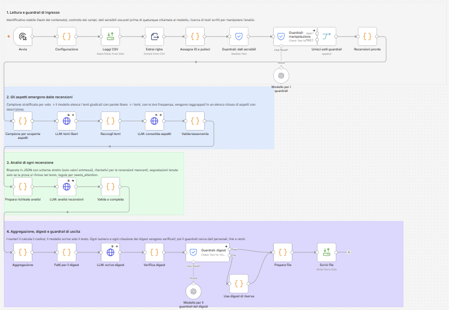

# Analisi delle recensioni di un hotel con n8n

È un workflow n8n che legge l'archivio delle recensioni di un hotel e produce senza interventi manuali:

- l'analisi di ogni recensione (lingua, sentiment complessivo, sentiment per aspetto, segnalazione per la direzione con il motivo);
- l'elenco degli aspetti emersi dalle recensioni, con una descrizione;
- l'aggregazione per aspetto, sull'intero archivio e nel tempo;
- il digest per la direzione, in italiano.

Le scelte progettuali, i limiti e la verifica su recensioni non usate durante lo sviluppo sono nella [relazione tecnica](RELAZIONE.md).



*Il workflow nell'interfaccia di n8n, con le sue quattro fasi (versione della relazione: memoria ed Excel sono arrivati dopo).*

**In breve.**
- 1.927 recensioni analizzate in meno di mezz'ora, per 1,29 dollari. Dal secondo giro bastano 18 secondi, perché le analisi si riprendono dalla memoria.
- Su 50 recensioni mai usate durante lo sviluppo, il giudizio complessivo coincide con quello di riferimento nel 90% dei casi (kappa di Cohen 0,83). Il riferimento l'ha dato alla cieca un modello diverso, non una persona.
- Sulle stesse 50 recensioni, le 12 da segnalare alla direzione per un problema preciso vengono trovate tutte; delle 20 segnalate, 12 sono giuste. I numeri sono piccoli: è un primo segnale, non una misura definitiva.
- Fra le recensioni usate per lo sviluppo e quelle tenute da parte nessuna differenza supera il rumore: il sistema non è tarato sulle recensioni viste.
- Un esempio dei risultati per chi non usa n8n: il file Excel in [`data/esempio_excel/`](data/esempio_excel/recensioni_hotel.xlsx).

**Il passo successivo.** Questo è il primo prototipo: un archivio di recensioni analizzato una volta. La versione per le app, che scarica da sola le recensioni da App Store e Google Play ogni settimana, manda avvisi su Telegram e controlla le recensioni coordinate, è nel repository [recensioni-app-n8n](https://github.com/aletafuro/recensioni-app-n8n).

## Cosa serve

- **Docker** con Docker Compose (Docker Desktop su Windows e macOS). Non serve installare n8n: l'immagine `n8nio/n8n:2.29.10` viene scaricata al primo avvio.
- Una **chiave API OpenAI**. Il modello predefinito è `gpt-4.1-mini`; per l'archivio completo la spesa è dell'ordine di 1-2 dollari.

## Avvio in tre passi

Dalla cartella del progetto:

1. Copia il file di esempio della configurazione e inserisci la chiave:

   ```bash
   cp .env.example .env
   ```

   Poi apri `.env` e scrivi la chiave dopo `OPENAI_API_KEY=`. Su Windows, in PowerShell, il comando è `copy .env.example .env`.

2. Lancia il workflow completo:

   ```bash
   docker compose run --rm esegui
   ```

   Il container importa il workflow in n8n, crea la credenziale OpenAI leggendo la chiave dal `.env` ed esegue tutto. Sull'archivio completo il primo giro dura circa mezz'ora (misurato: 29,7 minuti, 1,29 dollari): quasi tutto il tempo va nel guardrail che controlla le recensioni una per una. I giri successivi riprendono tutto dalla memoria e durano una ventina di secondi (vedi «Dopo la relazione» più sotto).

3. I risultati sono in `data/output/`. Alla fine di un giro riuscito n8n segna l'esecuzione come riuscita e `recensioni_analizzate.json` contiene 1.927 oggetti.

   **Attenzione:** un nuovo giro sovrascrive i risultati di questo repository, che sono quelli citati nella relazione. Per conservarli, copia prima la cartella o usa un'altra cartella di uscita (`-e OUTPUT_DIR=/files/nuovo_giro`). I numeri del primo nuovo giro saranno vicini ma non identici, perché il modello non risponde sempre allo stesso modo (relazione, sezione 9). Per esempio, in una prova del 16/11 le segnalazioni sono state 257 contro 266. Dal secondo giro in poi i risultati restano identici, perché si riprendono dalla memoria.

   I file:

   | file | contenuto |
   |---|---|
   | `recensioni_analizzate.json` | un oggetto per recensione, nello schema richiesto |
   | `recensioni_analizzate.jsonl` | lo stesso, una riga per recensione |
   | `aspetti.json` | elenco finale degli aspetti con descrizione e temi raggruppati |
   | `aggregazione.json` | conteggi, classifiche, periodi, andamento nel tempo, segnalazioni |
   | `digest.md` | testo per la direzione |
   | `esecuzione.json` | diagnostica: anomalie del file, guardrail, ritentativi, verifiche del digest |
   | `recensioni_diagnostica.jsonl` | dettaglio per recensione: segnalazioni con la frase di prova, temi fuori elenco |
   | `registro_giro.json` | durata del giro, token e costo per fase (il guardrail con il modello è una stima) |
   | `tabella_recensioni_aspetti.csv` | per Tableau, Excel o Power BI: una riga per ogni coppia recensione-aspetto, più una riga con l'aspetto vuoto per ogni recensione senza aspetti |
   | `tabella_aspetti_per_periodo.csv` | per Tableau, Excel o Power BI: una riga per ogni coppia periodo-aspetto, con i conteggi |
   | `recensioni_hotel.xlsx` | file Excel con 7 fogli: mesi, confronti, temi per mese, lingue, segnalazioni, recensioni (senza testo) e una guida alla lettura. Lo crea il prossimo giro: i risultati in questa cartella sono quelli della relazione, fatti prima di questa aggiunta. Un esempio è in `data/esempio_excel/` |
   | `memoria_analisi.json`, `memoria_guardrail.json` | la memoria per i giri successivi; si creano al primo giro |

### Elenco fisso degli aspetti

Gli aspetti usati per l'analisi stanno in `data/aspetti/aspetti_fissi.json`, con una versione: così i numeri di giri diversi si possono confrontare. Il file è nato da una scoperta automatica sulle recensioni (`aspetti_v1.json`) ed è stato poi rivisto. Le modifiche e i loro motivi sono scritti dentro il file. Il giro in `data/output/` usa questo elenco, quindi non contiene la scoperta. Un giro completo con la scoperta degli aspetti è in `data/output_scoperta/` e si rifà con `docker compose run --rm -e RISCOPRI_ASPETTI=true -e OUTPUT_DIR=/files/output_scoperta esegui`.

Per far emergere di nuovo gli aspetti dalle recensioni, senza usare l'elenco fisso:

```bash
docker compose run --rm -e RISCOPRI_ASPETTI=true esegui
```

Con le recensioni di un'altra attività l'elenco fisso non c'è (oppure va tolto): in quel caso il workflow fa sempre la scoperta.

### Prova veloce

Per vedere il flusso girare in pochi minuti su un campione ripetibile di 50 recensioni, salvando i risultati in una cartella a parte:

```bash
docker compose run --rm -e LIMIT=50 -e OUTPUT_DIR=/files/prova esegui
```

### Con l'interfaccia di n8n

```bash
docker compose up -d n8n
```

Poi apri http://localhost:5678. Al primo accesso n8n chiede di creare un utente locale (resta sul tuo computer). Il workflow **Analisi recensioni hotel** è già importato con la sua credenziale: aprilo e premi *Execute workflow*. Per fermare n8n:

```bash
docker compose down
```

## Dopo la relazione: tre aggiunte

Queste parti sono nate nella versione per le app ([recensioni-app-n8n](https://github.com/aletafuro/recensioni-app-n8n)) e sono state riportate qui perché servono anche a un archivio di recensioni. La relazione descrive il sistema prima di queste aggiunte.

**1. Memoria delle analisi.** Si mandano al modello solo le recensioni nuove o cambiate.
- Per ogni recensione `memoria_analisi.json` tiene la risposta del modello e una «firma»: istruzioni, elenco degli aspetti, categorie di segnalazione, modello, impostazioni della richiesta, dimensione dei gruppi e testo.
- Se la firma cambia, la recensione si rianalizza da sola. Un nuovo elenco degli aspetti o un nuovo contesto fanno rianalizzare tutto.
- Il controllo della manipolazione ha la sua memoria (`memoria_guardrail.json`).
- Validazione, controllo delle prove e regole si rifanno a ogni giro.
- Misurato il 16/11 sulle 1.927 recensioni: primo giro 29,7 minuti e 1,29 dollari; secondo giro 18 secondi e meno di un centesimo, con le 1.927 recensioni identiche campo per campo e l'aggregazione identica.
- Per rianalizzare tutto a mano basta cancellare i due file della memoria.
- Limite: con `BATCH_SIZE=5` la firma non tiene conto delle recensioni vicine nello stesso gruppo. Se si aggiungono recensioni, quelle già analizzate non vengono rifatte anche se i loro vicini sarebbero cambiati.

**2. Andamento mese per mese.** In `aggregazione.json` (`periodi_di_calendario`) e nel foglio «Mesi» dell'Excel.
- Ogni mese, dal primo all'ultimo con recensioni, ha la quota di recensioni negative confrontata con il mese prima. Anche i mesi vuoti restano nella serie.
- Il test su due proporzioni si fa solo se tutti e due i mesi hanno almeno 20 recensioni, con correzione per i confronti multipli; sotto si scrive «pochi dati».
- Il primo e l'ultimo mese sono segnati quando i dati li coprono solo in parte.
- Sull'archivio (256 mesi, dall'ottobre 2002 al gennaio 2024): 238 confronti con pochi dati, 17 entro il rumore, nessuno oltre il rumore.

**3. File Excel** (`recensioni_hotel.xlsx`), con 7 fogli:
- una guida alla lettura;
- mesi, confronti, temi per mese, lingue, segnalazioni;
- una riga per recensione, **senza il testo**, perché i testi hanno la loro licenza e si scaricano a parte (vedi «Dati»).

È costruito dal workflow senza librerie esterne. L'ho aperto con Excel senza errori.

Un esempio è in [`data/esempio_excel/recensioni_hotel.xlsx`](data/esempio_excel/recensioni_hotel.xlsx). Viene dal giro del 16/11, non da quello della relazione: per questo i numeri sono vicini ma non identici (per esempio 257 segnalazioni invece di 266).

## Verifica del sistema

Dopo l'esecuzione completa, le metriche si calcolano con:

```bash
docker compose run --rm verifica
```

La verifica non chiama il modello, ma Docker Compose chiede comunque che `OPENAI_API_KEY` nel `.env` non sia vuota (basta un valore qualsiasi).

Il workflow **Verifica del sistema (metriche)** legge i risultati in `data/output/` e scrive accanto `valutazione.json` e `valutazione.md`. Contengono:

- **A. sviluppo contro test:** le recensioni di test (`data/valutazione/test_ids.txt`) non sono mai state usate durante lo sviluppo; se il sistema fosse tarato sulle recensioni viste durante lo sviluppo, sul test andrebbe peggio;
- **B. gold set:** accuratezza rispetto alle 50 recensioni di test etichettate in `data/valutazione/gold_set.csv`.

Le stesse metriche le calcola, in modo indipendente, lo script Python `valutazione/verifica_generalizzazione.py` (controllo incrociato).

### Nella scheda Evaluations di n8n

Con l'interfaccia accesa (`docker compose up -d n8n`):

1. apri il workflow **Valutazione: carica gold set** e premi *Execute workflow*: crea la Data Table `gold_set_recensioni` con il gold set;
2. apri il workflow **Valutazione: Evaluations** e, nei nodi *Gold set (Evaluation Trigger)* e *Registra output*, scegli la tabella `gold_set_recensioni` dall'elenco. Serve solo la prima volta: n8n assegna alla tabella un identificativo interno nuovo su ogni macchina;
3. nella scheda **Evaluations** del workflow premi *Run evaluation*: per ogni recensione vedi il confronto con il gold set e la media delle metriche.

## Se qualcosa non va

- **Linux, errore di permessi su `data/`:** il container scrive con l'utente `node` (uid 1000). Se il tuo utente ha un uid diverso, dai i permessi di scrittura alla cartella: `chmod -R a+w data`.
- **Il giro si interrompe** (rete, limiti dell'API): basta rilanciarlo e ricomincia da capo. Dentro un giro, le recensioni la cui analisi fallisce vengono già ritentate da sole.
- **Il file `docker-compose.override.yml`**, se presente, serve solo sul computer dell'autrice e va cancellato: Docker Compose lo caricherebbe da solo.

## Configurazione

Tutto si regola nel file `.env` (vedi `.env.example`). Le voci principali sono:

| variabile | predefinito | significato |
|---|---|---|
| `OPENAI_API_KEY` | (obbligatoria) | chiave OpenAI |
| `LLM_MODEL` | `gpt-4.1-mini` | modello per scoperta degli aspetti, analisi e digest |
| `GUARDRAIL_MODEL` | `gpt-4.1-mini` | modello dei guardrail con controllo via LLM |
| `OPENAI_BASE_URL` | `https://api.openai.com/v1` | endpoint compatibile con l'API OpenAI |
| `INPUT_FILE` | `/files/input/ritz_carlton_reviews.csv` | file da analizzare (`data/` del progetto = `/files` nel container) |
| `OUTPUT_DIR` | `/files/output` | cartella dei risultati |
| `LIMIT` | `0` | 0 = tutte le recensioni; N = campione ripetibile di N recensioni |
| `BATCH_SIZE` | `5` | recensioni per chiamata nell'analisi |
| `DISCOVERY_SAMPLE` | `240` | recensioni lette per far emergere gli aspetti |
| `MIN_REVIEWS_PER_PERIOD` | `100` | minimo di recensioni per periodo nell'andamento nel tempo |
| `CONTEXT_FILE` | `/files/contesto/contesto.json` | contesto del dominio: chi è recensito, chi legge, categorie di segnalazione |
| `ASPECTS_FILE` | `/files/aspetti/aspetti_fissi.json` | elenco fisso degli aspetti (se manca, gli aspetti emergono dalle recensioni) |
| `RISCOPRI_ASPETTI` | `false` | `true` per ignorare l'elenco fisso e far emergere di nuovo gli aspetti |

Per analizzare un altro file basta copiarlo in `data/input/` e indicare `INPUT_FILE=/files/input/<nome>.csv`. Il file deve avere le colonne `title`, `rating`, `publishedDate`, `text` (`travelDate` è facoltativa).

## Struttura del progetto

```
docker-compose.yml          avvio di n8n (versione fissata) e dell'esecuzione completa
.env.example                configurazione da copiare in .env
docker/crea_credenziale.js  crea nel container la credenziale OpenAI dalla variabile d'ambiente
workflow/
  analisi_recensioni.json   IL WORKFLOW (si importa in n8n)
  src/*.js                  codice dei nodi Code, uno per file
  build_workflow.py         rimonta il workflow da src/ (serve solo se si modifica il codice)
data/
  input/                    archivio delle recensioni (non incluso: si scarica da Kaggle, vedi «Dati»)
  output/                   risultati del giro citato nella relazione
  esempio_excel/            il file Excel di un giro successivo, come esempio
  dev/, test/               divisione sviluppo / test (non inclusa: si ricrea con valutazione/crea_split.py)
valutazione/                script e risultati della verifica su recensioni non usate nello sviluppo
RELAZIONE.md                relazione tecnica
docs/                       immagine del workflow
LICENSE                     licenza del codice (MIT)
```

## Modificare il workflow

Il codice dei nodi Code sta in `workflow/src/`, un file per nodo, così si legge e si confronta facilmente. Dopo una modifica si rimonta il workflow con Python 3:

```bash
python workflow/build_workflow.py
```

e lo si rilancia: a ogni avvio il container reimporta il workflow aggiornato. Chi preferisce lavorare nell'interfaccia di n8n può farlo direttamente e poi esportare il workflow da lì.

## Dati

Dataset: [Ritz Carlton New York: 1900+ TripAdvisor Reviews](https://www.kaggle.com/datasets/kanchana1990/ritz-carlton-ny-2k-tripadvisor-reviews) di Kanchana1990 su Kaggle, licenza ODC Attribution License (ODC-By), 1.927 recensioni pubblicate su TripAdvisor.

**I testi delle recensioni non sono in questo repository.** La licenza del dataset permette di ridistribuirlo citando la fonte, ma le recensioni vengono da TripAdvisor, che ha i suoi termini d'uso: per prudenza qui non c'è l'archivio. Ci sono il codice, i risultati e alcune frasi brevi: le citazioni del digest e, per le recensioni segnalate, la frase che giustifica la segnalazione (in `recensioni_diagnostica.jsonl` e nel foglio Segnalazioni dell'Excel). Per rifare tutto:

1. scarica `ritz_carlton_reviews.csv` dalla pagina Kaggle e mettilo in `data/input/`;
2. ricrea la divisione sviluppo/test con `python valutazione/crea_split.py` (scrive `data/dev/`, `data/test/` e controlla gli identificativi di `data/valutazione/test_ids.txt`);
3. se vuoi rifare il gold set da etichettare: `python valutazione/scegli_gold_set.py`.

Le etichette del gold set (`data/valutazione/gold_set.csv`) e gli identificativi di test sono inclusi: non contengono testi.

## Licenza

Il codice è distribuito con licenza MIT (vedi `LICENSE`). Il dataset ha la sua licenza (ODC-By, vedi «Dati»).
